# Publications réseaux sociaux LumexIA

> Semaine du Black Friday 2026 : 9 publications pour Instagram, TikTok et LinkedIn, avec leurs visuels prêts à publier.
> Généré par `node src/social.mjs` à partir de `src/social-data.mjs` (ne pas modifier ce fichier à la main).
> Règles : skill [lumexia-post-reseaux](../.claude/skills/lumexia-post-reseaux/SKILL.md), [tone-of-voice.md](../brand/tone-of-voice.md), [design.md](../brand/design.md). Prix : [produits.md](../brand/produits.md) et [campagne/black-friday.md](../campagne/black-friday.md).
> Projet d'examen : LumexIA est une marque fictive, ces publications n'ont pas été publiées.

## Calendrier

| Date | Heure | Canal | Format | Segment | Publication |
| --- | --- | --- | --- | --- | --- |
| jeudi 26 novembre | 19 h 00 | Instagram | Story 9:16 | S2 amateurs de technologies | [Demain, on rallume](#p1-story-teaser) |
| vendredi 27 novembre | 7 h 30 | Instagram | Post 4:5 | S3 rénovation et S2 | [Pack Départ à 54,90 €](#p2-post-pack-bf) |
| samedi 28 novembre | 18 h 30 | Instagram | Carrousel 4:5, 5 vignettes | S1 jeunes actifs | [Le même salon, quatre lumières](#p3-carrousel-arc) |
| dimanche 29 novembre | 11 h 00 | Instagram | Post 4:5 | S2 amateurs de technologies | [Compatible avec ta maison](#p4-post-strip) |
| lundi 30 novembre | 18 h 00 | Instagram | Story 9:16 | Tous | [Ce soir, on éteint l'offre](#p5-story-dernier-jour) |
| mardi 1er décembre | 8 h 30 | LinkedIn | Post image 4:5 | Réseau professionnel, presse, partenaires | [Nos prix barrés sont nos vrais prix](#p6-linkedin-prix) |
| mercredi 2 décembre | 18 h 00 | Instagram | Post 4:5 | S1 jeunes actifs | [18 h, ta lampe a compris](#p7-post-halo) |
| jeudi 3 décembre | 12 h 30 | Instagram | Carrousel 4:5, 2 vignettes | S4 économies d'énergie | [Tu vois ce que tu consommes](#p8-carrousel-economies) |
| vendredi 4 décembre | 19 h 00 | Instagram Reels et TikTok | Vidéo 9:16, 15 s | S2 et S3 | [Vissé, allumé, réglé](#p9-reel-bulb) |

**Le fil rouge :** chaque publication se rattache à un moment de la journée (aube, jour, soir, nuit) ; la semaine suit le Black Friday (veille, offre, dernier jour, bilan), puis revient aux moments de vie.

**Comment les visuels sont faits :** les photos viennent de Gemini (prompts dans [docs/prompts-gemini.md](../docs/prompts-gemini.md)). Les textes, le logo et les prix sont ajoutés par des gabarits HTML aux couleurs de la charte, puis rendus en PNG par Google Chrome. Le texte reste donc net et sans faute, ce que les générateurs d'images ne garantissent pas.

---

## Demain, on rallume

| Canal | Format | Date | Segment | Objectif |
| --- | --- | --- | --- | --- |
| Instagram | Story 9:16 | jeudi 26 novembre, 19 h 00 | S2 amateurs de technologies | Prévenir du Black Friday |

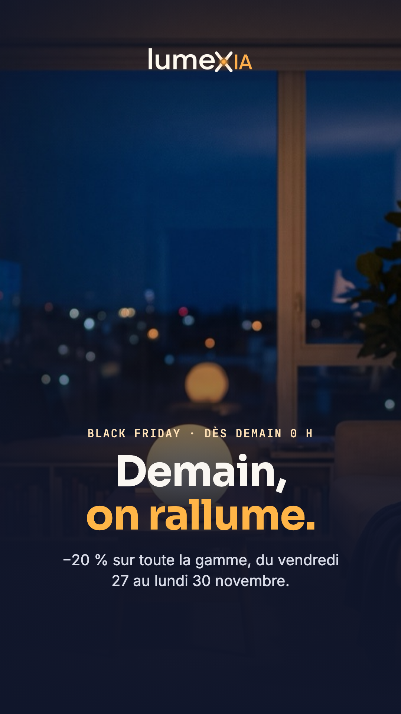

**Texte du visuel :** « Demain, on rallume. » + « −20 % sur toute la gamme, du vendredi 27 au lundi 30 novembre. »

**Texte alternatif :** Salon plongé dans la pénombre, une lampe ronde allumée sur une table basse. Texte : « Demain, on rallume. »

**À ajouter dans l'app :** Sticker « compte à rebours » d'Instagram, nommé « Black Friday LumexIA », qui se termine le vendredi 27 novembre à 0 h. Sticker lien vers la page Black Friday.

---

## Pack Départ à 54,90 €

| Canal | Format | Date | Segment | Objectif |
| --- | --- | --- | --- | --- |
| Instagram | Post 4:5 | vendredi 27 novembre, 7 h 30 | S3 rénovation et S2 | Faire acheter le Pack Départ |

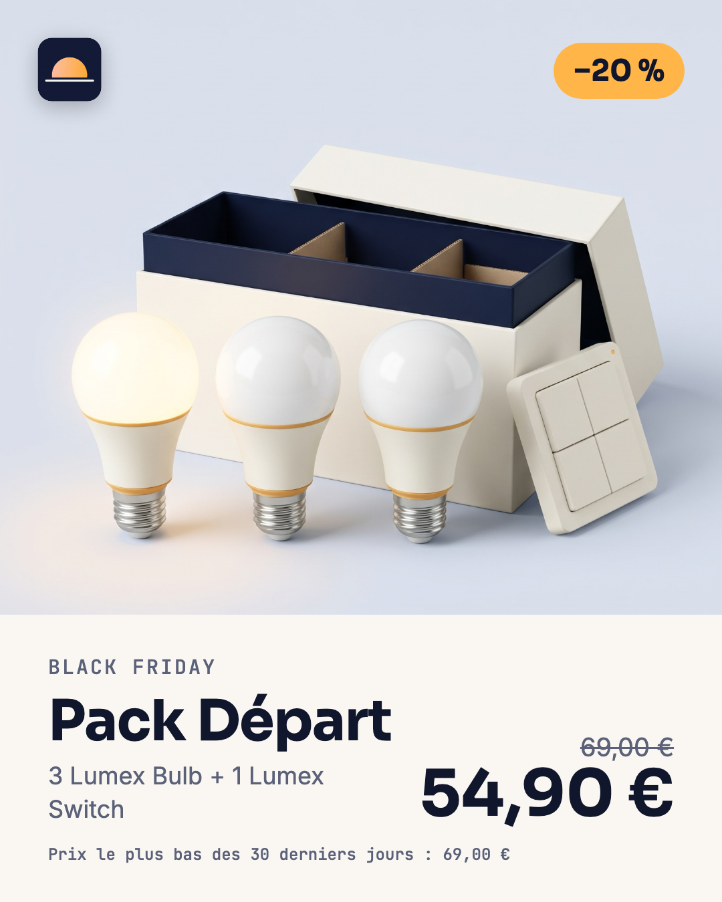

**Texte du visuel :** « Pack Départ » + « 3 Lumex Bulb + 1 Lumex Switch »

**Légende :**

> Le plus simple pour commencer coûte encore moins. ✨
> 
> Trois ampoules pour le salon, la cuisine et la chambre, et un interrupteur sans pile pour tout commander depuis l'entrée. Vissé, allumé, réglé.
> 
> Black Friday : 54,90 € au lieu de 69,00 € (prix le plus bas des 30 derniers jours), jusqu'au lundi 30 novembre à 23 h 59. Lien en bio.

**Hashtags :** #LumexIA #TaLumièreTonRythme #BlackFriday #MaisonConnectée #Éclairage

**Texte alternatif :** Coffret ivoire et bleu nuit ouvert, trois ampoules et un interrupteur carré posés devant, sur fond gris-bleu. Texte : Pack Départ, 54,90 €, au lieu de 69,00 €.

---

## Le même salon, quatre lumières

| Canal | Format | Date | Segment | Objectif |
| --- | --- | --- | --- | --- |
| Instagram | Carrousel 4:5, 5 vignettes | samedi 28 novembre, 18 h 30 | S1 jeunes actifs | Faire découvrir Lumex Sense |

 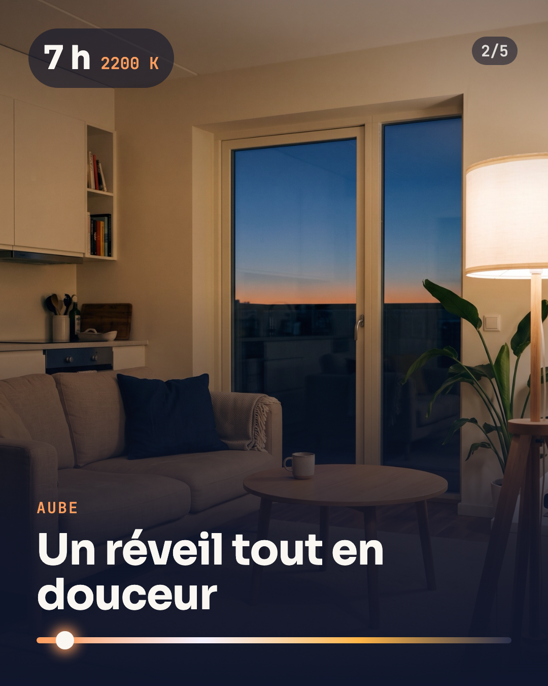 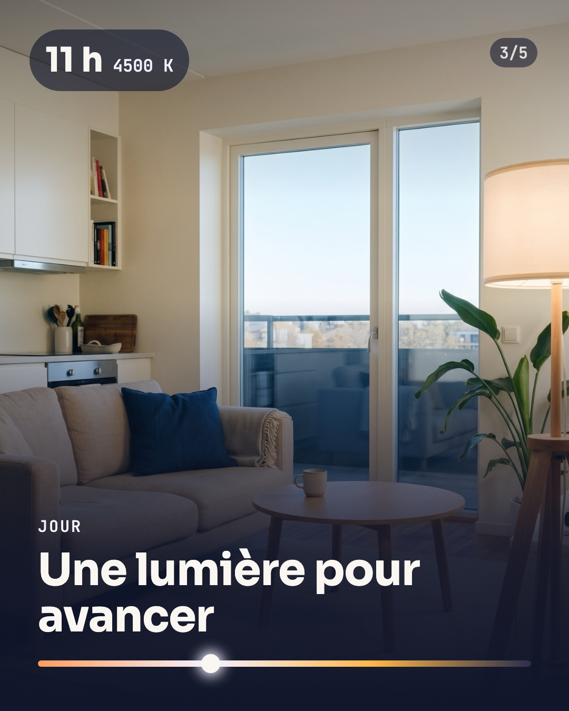 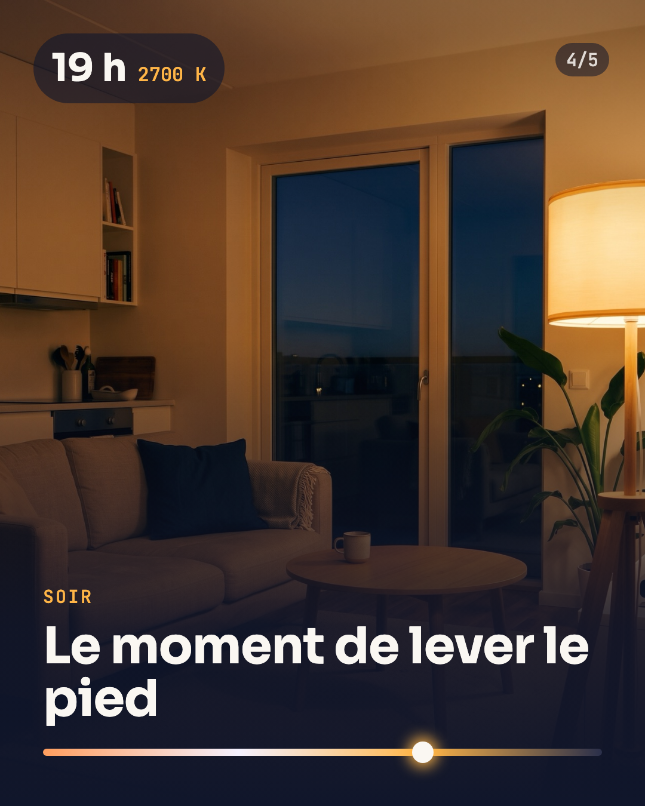 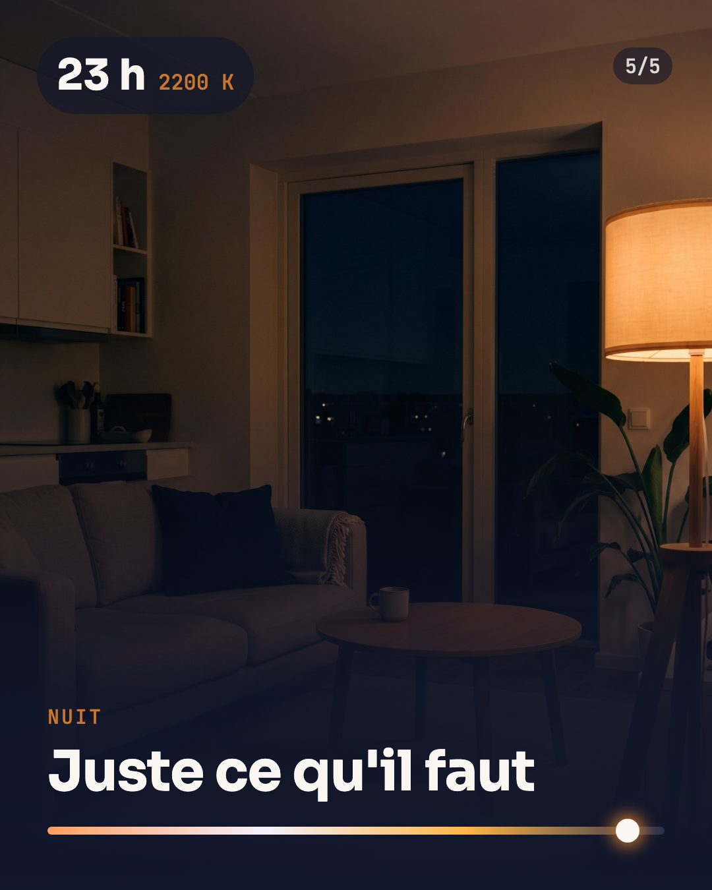

**Texte du visuel :** « Le même salon. Quatre lumières. » + « Glisse pour suivre la journée → » / « Un réveil tout en douceur » / « Une lumière pour avancer » / « Le moment de lever le pied » / « Juste ce qu'il faut »

**Légende :**

> Ta journée ne ressemble pas à un plafonnier. ☀️🌙
> 
> À 7 h, une lumière orangée pour te réveiller en douceur. À 11 h, un blanc net pour avancer. À 19 h, elle se réchauffe : la journée de travail est finie. À 23 h, juste une lueur pour aller te coucher.
> 
> C'est Lumex Sense, le mode gratuit de l'app Lumex. Ta lumière suit ta journée. Toute seule.
> 
> Et toi, ta lumière préférée, c'est à quelle heure ?

**Hashtags :** #LumexIA #TaLumièreTonRythme #LumexSense #DécoIntérieur #Télétravail

**Texte alternatif :** Le même salon photographié à quatre moments : à l'aube en lumière orangée, en journée en lumière blanche, le soir en lumière chaude, la nuit avec une seule lampe.

---

## Compatible avec ta maison

| Canal | Format | Date | Segment | Objectif |
| --- | --- | --- | --- | --- |
| Instagram | Post 4:5 | dimanche 29 novembre, 11 h 00 | S2 amateurs de technologies | Faire acheter Lumex Strip |

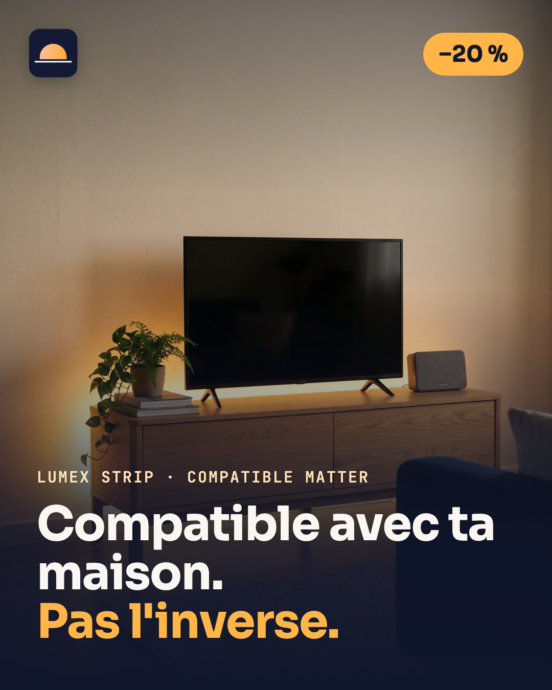

**Texte du visuel :** « Compatible avec ta maison. Pas l'inverse. »

**Légende :**

> Ton salon a déjà ses habitudes. Lumex Strip s'y fait. 💡
> 
> Un ruban LED de 2 mètres à coller derrière la télé ou sous une étagère. Compatible Matter : il fonctionne avec l'app Lumex et avec les assistants vocaux que tu utilises déjà.
> 
> Black Friday : 39,90 € au lieu de 49,90 € (prix le plus bas des 30 derniers jours), jusqu'à lundi 23 h 59.

**Hashtags :** #LumexIA #TaLumièreTonRythme #MaisonConnectée #Matter #BlackFriday

**Texte alternatif :** Meuble télé bas dans un salon le soir, souligné par un ruban de lumière ambrée. Texte : « Compatible avec ta maison. Pas l'inverse. »

---

## Ce soir, on éteint l'offre

| Canal | Format | Date | Segment | Objectif |
| --- | --- | --- | --- | --- |
| Instagram | Story 9:16 | lundi 30 novembre, 18 h 00 | Tous | Rappeler la fin réelle de l'offre |

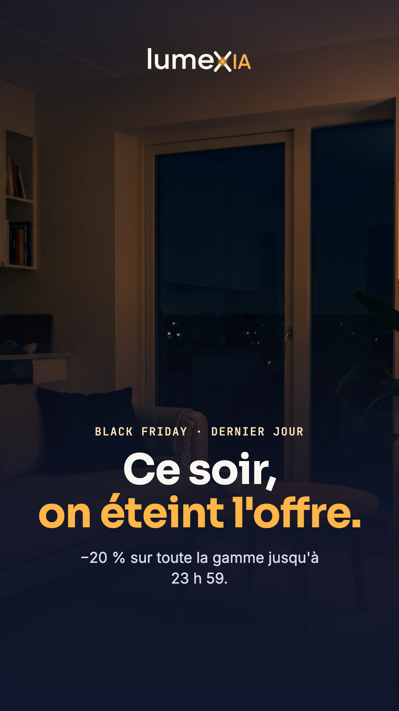

**Texte du visuel :** « Ce soir, on éteint l'offre. » + « −20 % sur toute la gamme jusqu'à 23 h 59. »

**Texte alternatif :** Salon la nuit, éclairé par une seule lampe à la lumière ambrée. Texte : « Ce soir, on éteint l'offre. »

**À ajouter dans l'app :** Sticker lien « Voir les offres » vers la page Black Friday. Pas de compte à rebours qui recommence : l'offre se termine vraiment à 23 h 59.

---

## Nos prix barrés sont nos vrais prix

| Canal | Format | Date | Segment | Objectif |
| --- | --- | --- | --- | --- |
| LinkedIn | Post image 4:5 | mardi 1er décembre, 8 h 30 | Réseau professionnel, presse, partenaires | Montrer les valeurs de la marque |

**Texte du visuel :** « Nos prix barrés sont nos vrais prix. » + « Pas de faux compte à rebours. Pas de prix gonflés. Pas de stock limité inventé. »

**Légende :**

> Pour notre premier Black Friday, nous avons pris trois décisions simples.
> 
> 1. Le prix barré est le prix le plus bas des 30 derniers jours, comme le demande la directive européenne Omnibus. Nous ne l'avons pas gonflé la semaine d'avant.
> 2. Notre compte à rebours suit la vraie date de fin. Il ne recommence pas quand on revient sur la page.
> 3. Nous n'avons écrit nulle part « stock limité » ou « dernières pièces », parce que ce n'était pas vrai.
> 
> Pourquoi ? LumexIA vend une lumière qui s'adapte à la journée de chacun et chacune. Une marque qui parle de confort et de sobriété énergétique ne peut pas pousser à acheter dans la précipitation.
> 
> L'offre s'est terminée hier soir. Les prix sont revenus à la normale.
> 
> LumexIA, éclairage connecté conçu en Belgique.

**Hashtags :** #Marketing #Omnibus #ÉclairageConnecté #LumexIA

**Texte alternatif :** Fond bleu nuit avec un arc de lumière ambrée. Texte : « Nos prix barrés sont nos vrais prix. »

---

## 18 h, ta lampe a compris

| Canal | Format | Date | Segment | Objectif |
| --- | --- | --- | --- | --- |
| Instagram | Post 4:5 | mercredi 2 décembre, 18 h 00 | S1 jeunes actifs | Faire acheter Lumex Halo |

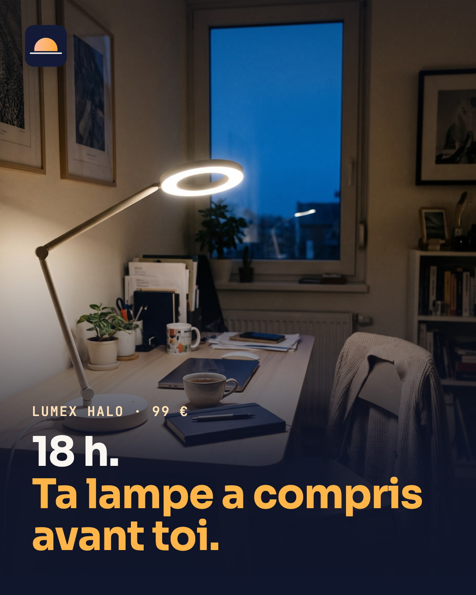

**Texte du visuel :** « 18 h. Ta lampe a compris avant toi. »

**Légende :**

> POV : il est 18 h et ta lampe a compris avant toi qu'il était temps de lever le pied. 🌙
> 
> Lumex Halo éclaire ton bureau d'un blanc net pendant la journée, puis passe à une lumière plus chaude et plus douce en fin d'après-midi. Le signal que tu peux fermer l'ordi.
> 
> 99 €, sans abonnement. Lien en bio.

**Hashtags :** #LumexIA #TaLumièreTonRythme #Télétravail #BureauÀLaMaison #LumexHalo

**Texte alternatif :** Bureau à domicile en fin de journée, éclairé par une lampe articulée ivoire à tête ronde. Texte : « 18 h. Ta lampe a compris avant toi. »

---

## Tu vois ce que tu consommes

| Canal | Format | Date | Segment | Objectif |
| --- | --- | --- | --- | --- |
| Instagram | Carrousel 4:5, 2 vignettes | jeudi 3 décembre, 12 h 30 | S4 économies d'énergie | Faire acheter le lot de 3 Lumex Bulb |

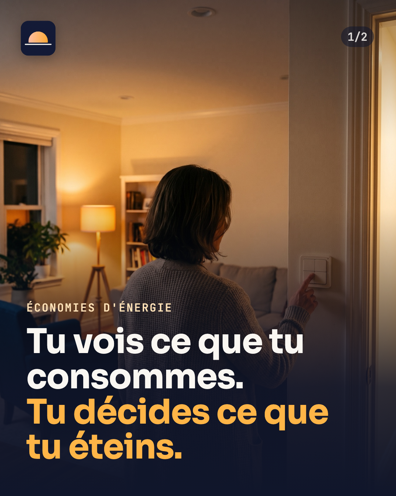 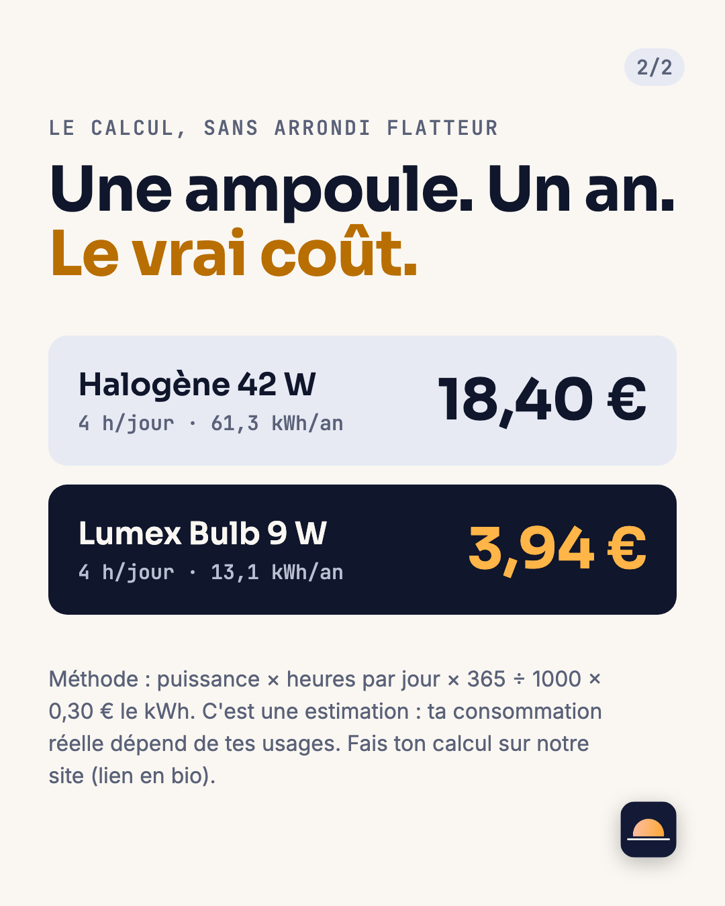

**Texte du visuel :** « Tu vois ce que tu consommes. Tu décides ce que tu éteins. » / calcul (halogène 42 W : 18,40 € par an ; Lumex Bulb 9 W : 3,94 € par an ; méthode affichée)

**Légende :**

> L'hiver, la lumière reste allumée plus longtemps. Autant savoir ce qu'elle coûte. 💡
> 
> Une halogène de 42 W allumée 4 h par jour consomme environ 61,3 kWh par an. Une Lumex Bulb de 9 W, environ 13,1 kWh. Avec un kWh à 0,30 €, ça fait environ 14,45 € de différence par an et par ampoule.
> 
> C'est une estimation, pas une promesse : fais ton propre calcul sur notre site, la méthode est affichée. Et dans l'app Lumex, tu vois ta consommation pièce par pièce.
> 
> Lumex Bulb : 17,90 € l'ampoule, 44,90 € le lot de 3.

**Hashtags :** #LumexIA #TaLumièreTonRythme #ÉconomiesDÉnergie #Hiver #LED

**Texte alternatif :** Une personne appuie sur un interrupteur dans un salon éclairé le soir. Deuxième vignette : le calcul, 18,40 € par an pour une halogène de 42 W contre 3,94 € pour une Lumex Bulb de 9 W.

---

## Vissé, allumé, réglé

| Canal | Format | Date | Segment | Objectif |
| --- | --- | --- | --- | --- |
| Instagram Reels et TikTok | Vidéo 9:16, 15 s | vendredi 4 décembre, 19 h 00 | S2 et S3 | Faire découvrir Lumex Bulb |

**Texte du visuel :** « Vissé. Allumé. Réglé. » + « Ta lumière fait ça, toi ? »

**Légende :**

> Ta lumière fait ça, toi ? ✨
> 
> Tu visses Lumex Bulb, tu ouvres l'app, et Lumex Sense s'occupe du reste : blanche le jour, ambrée le soir, presque rien la nuit.
> 
> 17,90 € l'ampoule, 44,90 € le lot de 3. Sans abonnement.

**Hashtags :** #LumexIA #TaLumièreTonRythme #MaisonConnectée #DécoIntérieur #Astuce

**Texte alternatif :** Couverture de la vidéo : salon le soir éclairé par une suspension ambrée. Texte : « Vissé. Allumé. Réglé. »

**À ajouter dans l'app :** Musique : piste calme libre de droits de la bibliothèque audio de la plateforme (aucun titre sous droits). Sous-titres incrustés pour un visionnage sans le son.

**Storyboard (15 s) :**

| Temps | Image | Texte à l'écran | Son |
| --- | --- | --- | --- |
| 0–3 s | Plan serré : une main visse une ampoule dans une suspension, pièce dans la pénombre. | « Ta lumière fait ça, toi ? » | Petit clic |
| 3–6 s | L'ampoule s'allume, la pièce se remplit d'une lumière ambrée. | « Vissé. » | Début de la musique |
| 6–9 s | Le téléphone : on active Lumex Sense dans l'app Lumex (écran générique, sans marque d'autrui). | « Allumé. » | — |
| 9–13 s | Accéléré : la même pièce passe de la lumière du jour à la lumière du soir, puis à la veilleuse de nuit. | « Réglé. Toute seule. » | Montée de la musique |
| 13–15 s | Plan final : Lumex Bulb allumée sur fond Nuit, logo LumexIA. | « Lumex Bulb · 17,90 € · Lien en bio » | Fin |

---

## Vérification avant publication (skill lumexia-verif-marque)

- [x] Tutoiement, phrases courtes, un moment de vie avant le produit (sauf LinkedIn : « nous », ton professionnel).
- [x] Prix conformes à `brand/produits.md` ; prix Black Friday avec le prix le plus bas des 30 derniers jours.
- [x] Aucune fausse urgence : les dates de fin sont les vraies, aucun « stock limité ».
- [x] Économies : estimation avec la méthode de calcul, pas de pourcentage promis.
- [x] Aucun avis, chiffre de vente ou partenariat inventé ; aucune marque d'autrui.
- [x] 1 ou 2 emojis au maximum, de la famille lumière (☀️ 🌙 ✨ 💡).
- [x] Toujours `#LumexIA` et `#TaLumièreTonRythme` sur Instagram et TikTok.
- [x] Un texte alternatif pour chaque visuel.
