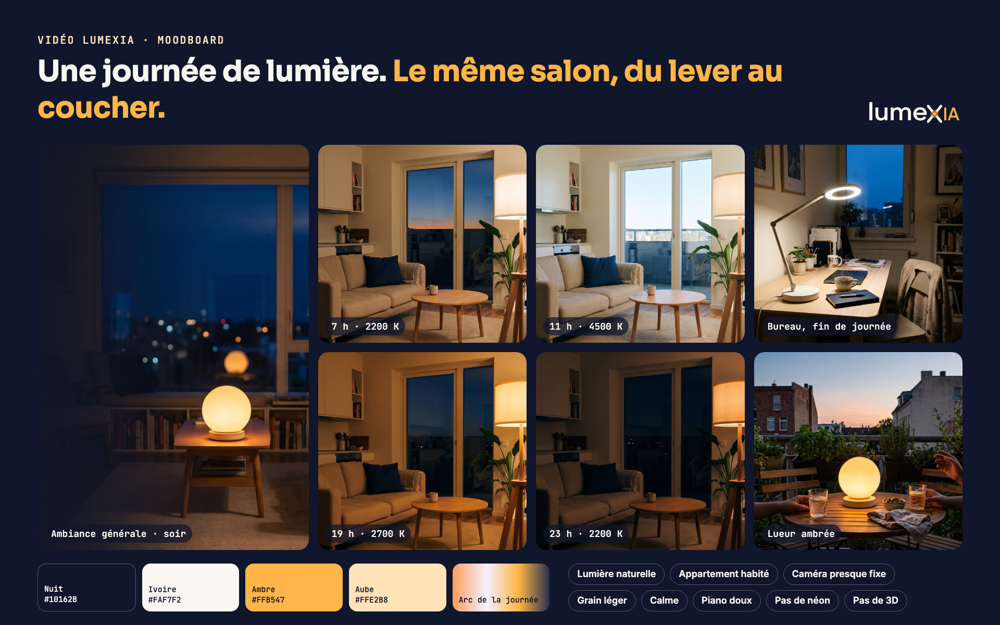
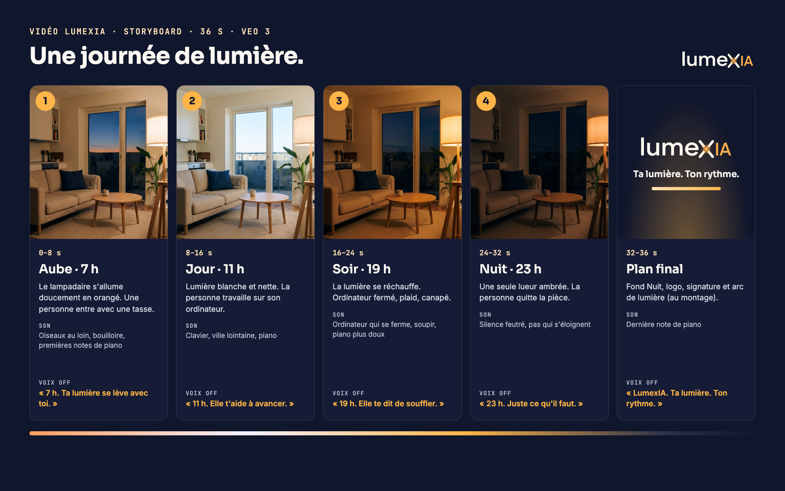

# Vidéo LumexIA : « Une journée de lumière »

> Film de marque de 36 secondes, généré avec **Veo 3** (dans Gemini), puis monté (CapCut, iMovie ou Canva).
> Visuels de préparation : [moodboard.png](moodboard.png) et [storyboard.png](storyboard.png), générés par `node src/video.mjs`.
> Règles : [brand/design.md](../brand/design.md) (photos, couleurs), [brand/tone-of-voice.md](../brand/tone-of-voice.md) (ton), [brand/projet.md](../brand/projet.md) (lignes rouges).

---

## 1. Le concept

**Le même salon, du lever au coucher.** La caméra ne bouge presque pas : c'est la lumière qui raconte la journée. À l'aube, elle est orangée et monte doucement ; en journée, elle est blanche et nette ; le soir, elle se réchauffe ; la nuit, il ne reste qu'une lueur ambrée. C'est la promesse de **Lumex Sense**, montrée sans un mot technique.

| | |
| --- | --- |
| **Durée** | 36 s : 4 plans de 8 s générés par Veo 3 + 4 s de plan final ajouté au montage |
| **Formats** | 16:9 pour le site et YouTube ; recadrage 9:16 pour Reels et TikTok |
| **Cible** | S1 jeunes actifs (Sam, 27 ans, télétravail en appartement) |
| **Message** | Ta lumière suit ta journée. Toute seule. |
| **Signature finale** | Ta lumière. Ton rythme. |
| **Voix** | Voix off féminine, française, calme et chaleureuse, 4 phrases courtes |
| **Musique** | Piano et nappes douces, libre de droits (aucun titre sous droits) |

## 2. Le moodboard



- **Lumière :** la lumière des lampes est la source principale ; on doit lire l'heure à la couleur (2200 K à l'aube et la nuit, 4500 K le jour, 2700 K le soir).
- **Lieu :** un vrai appartement d'adulte, habité : canapé beige, coussins bleu nuit, table basse ronde en bois, lampadaire à abat-jour en lin, grande baie vitrée, plantes, bibliothèque.
- **Couleurs :** Nuit `#10162B`, Ivoire `#FAF7F2`, Ambre `#FFB547`, Aube `#FFE2B8`.
- **Image :** photographie naturelle, léger grain, cadrage un peu imparfait. Pas de rendu 3D, pas de néon, pas de couleurs saturées.
- **Personne :** une seule personne adulte, vue de dos ou de trois quarts, jamais de visage net en gros plan.

## 3. Le storyboard



| # | Temps | Image | Voix off | Son |
| --- | --- | --- | --- | --- |
| 1 | 0–8 s | **Aube, 7 h.** Le salon dans le bleu du matin. Le lampadaire s'allume tout doucement en orangé. Une personne entre, une tasse à la main, et regarde par la fenêtre. | « 7 h. Ta lumière se lève avec toi. » | Oiseaux au loin, bouilloire, début du piano |
| 2 | 8–16 s | **Jour, 11 h.** Lumière blanche et nette. La personne travaille sur son ordinateur à la table basse, concentrée. | « 11 h. Elle t'aide à avancer. » | Clavier, ville lointaine |
| 3 | 16–24 s | **Soir, 19 h.** Le ciel devient bleu profond, la lumière se réchauffe et baisse d'un cran. La personne ferme l'ordinateur et s'installe dans le canapé avec un plaid. | « 19 h. Elle te dit de souffler. » | Ordinateur qui se ferme, soupir détendu, piano plus doux |
| 4 | 24–32 s | **Nuit, 23 h.** Une seule lampe ronde reste allumée, très basse. La personne pose son livre et quitte la pièce ; la lumière diminue encore. | « 23 h. Juste ce qu'il faut. » | Silence feutré, dernière note de piano |
| 5 | 32–36 s | **Plan final (montage).** Fond Nuit, logo LumexIA inversé, signature en Ivoire, arc de lumière Aube → Ambre. | « LumexIA. Ta lumière. Ton rythme. » | Note finale |

## 4. Les prompts Veo 3

### Conseils d'utilisation

1. Dans Gemini, choisis **Vidéo (Veo 3)**. Un prompt donne un plan de **8 secondes**, avec le son.
2. **Pour que le salon soit le même dans les 4 plans**, joins l'image de départ correspondante (`arc-aube.jpg`, `arc-jour.jpg`, `arc-soir.jpg`, `arc-nuit.jpg` dans `site/assets/img/`) : Veo anime la photo au lieu d'inventer une nouvelle pièce.
3. Les prompts sont en anglais (Veo les comprend mieux) ; la voix off est en français, entre guillemets.
4. Ne demande **jamais de texte à l'écran** à Veo (il l'écrit mal) : le logo, la signature et les sous-titres s'ajoutent au montage.
5. Si la voix générée sonne faux, régénère le plan avec « No voice-over. » et enregistre la voix off séparément (ou avec une voix de synthèse) au montage.
6. Garde une capture d'écran de chaque prompt et du résultat pour le rapport.

### Prompt A : le film en un seul plan de 8 secondes (version courte)

Pour un teaser rapide ou si tu n'as qu'un essai. Joins `arc-jour.jpg`.

```text
A static wide shot of the same cozy, lived-in apartment living room, filmed as a smooth time-lapse of one full day in 8 seconds. Beige fabric sofa with navy blue cushions, round light-wood coffee table, a floor lamp with a linen shade, a small round glowing table lamp, a large balcony window with a city view, green plants, a bookshelf.

The story is told only by the light. It starts at dawn: blue morning light outside, the lamps glow a soft orange (2200 K) and slowly brighten. Then daytime: bright, neutral white light fills the room. Then evening: the sky turns deep blue and the lamps shift to a warm amber glow (2700 K), dimmer and cozy. It ends at night: everything is dark except one small round lamp giving a low amber glow.

Camera locked on a tripod, no camera movement. Natural interior photography, soft real-world light falloff, subtle film grain, realistic, not a 3D render, not glossy, not oversaturated. No people. No text, no logos, no brand names.

Audio: gentle ambient sound evolving with the day, distant birds at dawn, soft city murmur at noon, quiet evening, calm silence at night, with a soft, warm piano melody. A calm, warm female voice says in French: "Ta lumière suit ta journée. Toute seule."
```

### Prompt B : le film complet en 4 plans (36 s)

Même description du salon dans chaque prompt, pour que Veo garde la même pièce. Joins l'image indiquée.

**Plan 1 : aube (joins `arc-aube.jpg`)**

```text
Same cozy, lived-in apartment living room as the reference image: beige fabric sofa with navy blue cushions, round light-wood coffee table, floor lamp with a linen shade, large balcony window, green plants, bookshelf.

7 a.m., dawn. Outside the window the sky is deep blue with a thin orange line on the horizon. The floor lamp turns on very slowly with a soft orange glow (2200 K), gradually filling the room with warm light, like a sunrise inside. An adult person in a cozy knit sweater, seen from behind, walks into the frame holding a steaming mug and stops by the window to look outside.

Slow, gentle push-in of the camera. Natural interior photography, the lamp is the main light source, soft real-world light falloff, subtle film grain, slightly imperfect framing, realistic, not a 3D render, not glossy, not oversaturated. No text, no logos, no brand names, no face close-up.

Audio: distant birds, a kettle clicking off in the background, the first soft notes of a calm piano melody. A calm, warm female voice says in French: "Sept heures. Ta lumière se lève avec toi."
```

**Plan 2 : jour (joins `arc-jour.jpg`)**

```text
Same cozy, lived-in apartment living room as the reference image: beige fabric sofa with navy blue cushions, round light-wood coffee table, floor lamp with a linen shade, large balcony window, green plants, bookshelf.

11 a.m., bright day. Clear daylight comes through the window and the room is lit with a crisp, neutral white light (4500 K). The same adult person in a knit sweater sits on the sofa, seen from a three-quarter back angle, working on a laptop placed on the coffee table, focused and relaxed. A cup of coffee next to the laptop.

Slow lateral dolly movement from left to right. Natural interior photography, soft real-world light falloff, subtle film grain, realistic, not a 3D render, not glossy, not oversaturated. The laptop screen is a soft blur with no readable content. No text, no logos, no brand names, no face close-up.

Audio: soft keyboard typing, a faint city murmur through the window, the calm piano melody continues. A calm, warm female voice says in French: "Onze heures. Elle t'aide à avancer."
```

**Plan 3 : soir (joins `arc-soir.jpg`)**

```text
Same cozy, lived-in apartment living room as the reference image: beige fabric sofa with navy blue cushions, round light-wood coffee table, floor lamp with a linen shade, large balcony window, green plants, bookshelf.

7 p.m., evening. Outside, the sky turns deep blue and city lights appear. The lamps slowly shift from white to a warm amber glow (2700 K) and dim slightly; the room becomes cozy. The same adult person closes the laptop, stretches, pulls a navy blue blanket over their legs and settles back into the sofa.

Static medium shot, then a very slow pull-back. Natural interior photography, the lamps are the main light source, soft real-world light falloff, subtle film grain, realistic, not a 3D render, not glossy, not oversaturated. No text, no logos, no brand names, no face close-up.

Audio: the soft click of a laptop closing, a relaxed sigh, the piano becomes softer and slower. A calm, warm female voice says in French: "Dix-neuf heures. Elle te dit de souffler."
```

**Plan 4 : nuit (joins `arc-nuit.jpg`)**

```text
Same cozy, lived-in apartment living room as the reference image: beige fabric sofa with navy blue cushions, round light-wood coffee table, floor lamp with a linen shade, large balcony window, green plants, bookshelf.

11 p.m., night. The room is dark and calm, the city lights are dim outside the window. Only one small round table lamp remains on, giving a very low amber glow (2200 K) on the coffee table. The same adult person puts a book down on the table, stands up and slowly walks out of the frame. After they leave, the lamp dims even further, to a gentle night-light glow.

Locked-off static wide shot. Natural interior photography, soft real-world light falloff, deep shadows, subtle film grain, realistic, not a 3D render, not glossy, not oversaturated. No text, no logos, no brand names, no face close-up.

Audio: muffled quiet room tone, soft footsteps fading away, the last gentle note of the piano. A calm, warm female voice whispers in French: "Vingt-trois heures. Juste ce qu'il faut."
```

> Dans la voix off, les heures sont écrites en toutes lettres (« Sept heures ») pour que Veo les prononce correctement. Le résultat dit bien « 7 h ».

### Plan 5 : le plan final (au montage, pas avec Veo)

Durée 4 s. Fond Nuit `#10162B`. Au centre, le logo inversé (`src/static/logo-inverse.png`), apparition en fondu de 500 ms. En dessous, « Ta lumière. Ton rythme. » en Sora, couleur Ivoire, puis un arc de lumière en dégradé Aube → Ambre qui s'allume de gauche à droite. Voix off : « LumexIA. Ta lumière. Ton rythme. » Dernière note de piano.

## 5. Le montage

1. Importe les 4 plans dans l'ordre, enchaînés par des fondus de 0,5 s (la lumière continue d'un plan à l'autre).
2. Ajoute le plan final.
3. Sous-titres en Inter blanc, en bas, pour un visionnage sans le son (beaucoup de vidéos sont regardées sans le son sur les réseaux).
4. Exporte en 1920 × 1080 (site, YouTube), puis recadre en 1080 × 1920 pour Reels et TikTok, en gardant la lampe dans le cadre.
5. Vérifie avec le skill `lumexia-verif-marque` : aucune promesse de santé (« t'aide à », jamais « améliore ton sommeil »), aucun logo d'autrui visible, aucun clignotement.
